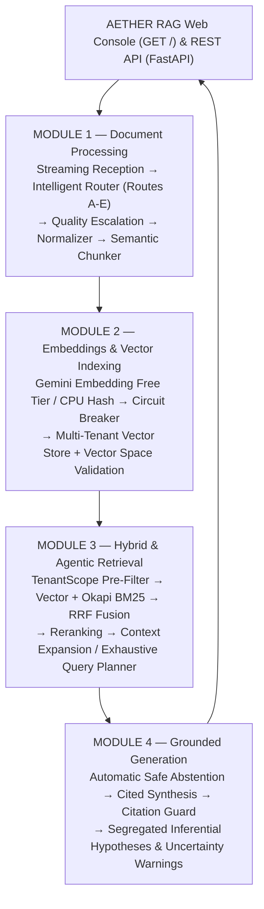
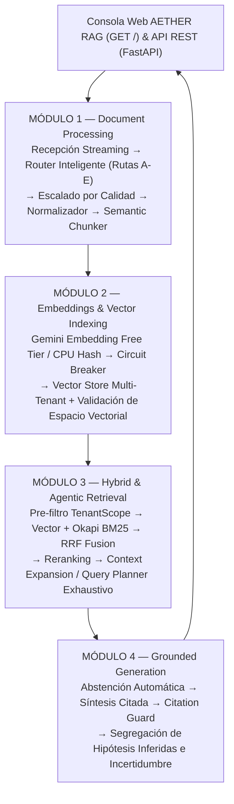

# AETHER RAG — Enterprise Document Intelligence Platform

> 🌐 **Bilingual Documentation:** [English Version (Part 1)](#english-version) | [Versión en Español (Parte 2)](#versión-en-español)

---

<a name="english-version"></a>
# Part 1 — English Version

Enterprise-grade, multi-format **RAG (Retrieval-Augmented Generation)** platform featuring **verifiable evidence citations**, **epistemological safety**, **native pre-retrieval multi-tenant isolation**, and **Gemini API Free Tier** orchestration. Executed **100% in Google Cloud Platform (GCP) and GitHub Actions** under a strict *Zero Local Compute* directive.

---

## 1. End-to-End Architecture (Modules 1 to 4)



---

## 2. Core Engineering & Security Invariants

1. **Zero Local Compute (*Cloud-Only Execution*):**
   - The developer workstation is strictly used for code authoring and `git push`. All linting (`Ruff`), unit/integration tests (`Pytest`), container builds (`Docker`), and infrastructure provisioning (`Terraform` / `Cloud Run`) run exclusively in **GitHub Actions and GCP**.
2. **Epistemological Safety & Document Fidelity:**
   - Strict contract-level separation between **observed transcription** (`observed_text`), **uncertain/illegible spans** (`[ilegible]`), and **inferred contextual hypotheses** (`inferred_context_notes`).
   - The **Citation Guard** ([`generator.py`](src/rag_platform/generation/generator.py)) raises `CitationVerificationError` if any synthesizer attempts to cite a non-existent `chunk_id` or leak an inferred hypothesis as observed fact.
3. **Pre-Retrieval Multi-Tenant Isolation:**
   - Every operation requires explicit `X-Tenant-Id` and `X-Project-Id` headers. Both the Vector Store ([`vector_store.py`](src/rag_platform/indexing/vector_store.py)) and BM25 Lexical Index ([`lexical_bm25.py`](src/rag_platform/retrieval/lexical_bm25.py)) filter candidate records via [`TenantScope.matches_filter`](src/rag_platform/contracts/tenant.py) **before** computing similarity scores.
4. **FinOps & Gemini API Free Tier Cost Guard:**
   - Strictly locked to the **Gemini API Free Tier** (`allow_paid_tier=False` enforced by Pydantic validators), featuring bounded batching, exponential retry, a consecutive-failure **Circuit Breaker**, and automatic graceful degradation to CPU/extractive mode on HTTP `429` without enabling paid billing.
5. **Embedding Space Compatibility:**
   - [`assert_embedding_compatibility`](src/rag_platform/contracts/embedding.py) validates provider, model, model version, vector dimension, and chunking version prior to every index upsert or query.

---

## 3. Repository Structure

```text
├── .agents/rules/                     # Mandatory governance rules (isolation, architecture, DevOps)
├── .github/workflows/
│   ├── ci.yml                         # Commit governance (Feature<N>:), Ruff Lint & Pytest (33 tests)
│   ├── terraform-plan.yml             # Terraform fmt, validate, and plan on PRs/pushes
│   ├── terraform-apply.yml            # Pipeline 1: Provision base GCP infrastructure (Buckets & IAM)
│   ├── deploy-dev.yml                 # Pipeline 2: Build Docker image & deploy AETHER RAG to Cloud Run
│   └── terraform-destroy.yml          # Pipeline 3: Full teardown (Cloud Run + AR + Buckets) to $0.00
├── infra/
│   ├── modules/{identity,storage,compute}/
│   └── envs/dev/                      # Remote GCS state and declarative DEV environment IaC
├── src/rag_platform/
│   ├── contracts/                     # Versioned Pydantic v2 contracts (Modules 1–4)
│   ├── processing/                    # Module 1: reception.py, router.py (Routes A-E), normalizer.py, chunker.py
│   ├── indexing/                      # Module 2: embedder.py, vector_store.py
│   ├── retrieval/                     # Module 3: lexical_bm25.py, hybrid_retriever.py, agentic_retriever.py
│   ├── generation/                    # Module 4: generator.py (GroundedAnswerGenerator & Citation Guard)
│   ├── adapters/                      # HTTPX client for Gemini Developer API Free Tier (gemini_client.py)
│   ├── benchmark/                     # Reproducible CER, WER, Recall@K, MRR, and nDCG@K evaluator
│   ├── api/                           # FastAPI service (app.py, schemas.py) & AETHER RAG Web UI (ui.py)
│   └── orchestrator.py                # End-to-End facade (RAGPlatformOrchestrator)
├── tests/unit/                        # 33 unit & E2E integration tests (>90% coverage)
├── Dockerfile                         # Multi-stage non-root (appuser) Cloud Run container
└── pyproject.toml                     # Package dependencies, Ruff, and Pytest configuration
```

---

## 4. REST API & AETHER RAG Executive Web Console

| Method & Path | Description | Required Headers |
|---|---|---|
| `GET /` | **AETHER RAG Executive Web Console** (Apple/Fluent Glassmorphic UI) with 1-click demo dossier, tenant switcher, and epistemic visualization. | None |
| `GET /health` | Live engine health status, version, and per-tenant indexed chunk counts. | None |
| `POST /v1/documents/ingest` | Multi-page document ingestion, Module 1 routing, and Module 2/3 hybrid indexing (`201 Created`). | `X-Tenant-Id`, `X-Project-Id` |
| `POST /v1/rag/ask` | Execute `standard_hybrid` or `deep_agentic` RAG returning cited claims, `[ilegible]` warnings, and segregated hypotheses (`200 OK`). | `X-Tenant-Id`, `X-Project-Id` |
| `DELETE /v1/documents/{document_id}` | Tenant-scoped deletion of all vector and lexical entries for a document. | `X-Tenant-Id`, `X-Project-Id` |
| `GET /docs` | Interactive OpenAPI / Swagger UI documentation. | None |

---

## 5. Exact Pipeline Execution Order for Cloud Deployment & Zero-Cost Teardown

From the **Actions** tab in GitHub, run the manual workflows in this exact order:

1. **Step 1 — Provision Base GCP Infrastructure (`IaC — Terraform Apply (Deploy DEV Infrastructure)`):**
   - Select **`IaC — Terraform Apply (Deploy DEV Infrastructure)`** (`terraform-apply.yml`) → Click **Run workflow** (`target_env: dev`).
   - *What it does:* Creates the Terraform state bucket, isolated GCS document/artifact buckets (`bitcitychamp-project-rag-documents-dev`), and least-privilege GCP Service Accounts.
2. **Step 2 — Deploy Container & Web UI to Cloud Run (`CD — Deploy RAG Service & UI to Cloud Run (DEV)`):**
   - Select **`CD — Deploy RAG Service & UI to Cloud Run (DEV)`** (`deploy-dev.yml`) → Click **Run workflow** (`use_live_gemini: false` for deterministic zero-quota testing, or `true` to use your `GEMINI_API_KEY` Free Tier).
   - *What it does:* Builds the `Dockerfile`, pushes the immutable image digest to Artifact Registry, deploys `rag-api-dev` to **Google Cloud Run** (`--min-instances=0`), and prints the public **Live Console URL** (`https://rag-api-dev-...run.app`) in the workflow summary.
3. **Step 3 — Teardown Everything Back to $0.00 (`IaC — Terraform Destroy (Teardown to Zero Cost)`):**
   - When you finish testing, select **`IaC — Terraform Destroy (Teardown to Zero Cost)`** (`terraform-destroy.yml`) → Type **`DESTROY`** → Click **Run workflow**.
   - *What it does:* Deletes the Cloud Run service, Artifact Registry repository, GCS buckets, Service Accounts, and state bucket so your GCP account returns to **$0.00 residual cost**.

---
---

<a name="versión-en-español"></a>
# Parte 2 — Versión en Español

Plataforma empresarial **RAG (Retrieval-Augmented Generation)** multiformato con **evidencia verificable**, **seguridad epistemológica**, **aislamiento multi-tenant nativo** y orquestación con **Gemini API Free Tier**, ejecutada **100% en Google Cloud Platform (GCP) y GitHub Actions** bajo la directiva de *Cero Cómputo Local*.

---

## 1. Arquitectura General (Módulos 1 al 4)



---

## 2. Invariantes Críticas de Ingeniería

1. **Cero Cómputo Local (*Cloud-Only Execution*):**
   - La máquina local se utiliza únicamente como estación de edición y Git. Toda validación, linting (`Ruff`), pruebas (`Pytest`), construcción de contenedores (`Docker`) y despliegue (`Terraform` / `Cloud Run`) se ejecuta en **GitHub Actions y GCP**.
2. **Seguridad Epistemológica y Fidelidad Documental:**
   - Separación estricta a nivel de contrato entre **transcripción observada** (`observed_text`), **pasajes inciertos** (`[ilegible]`) e **hipótesis inferidas** (`inferred_context_notes`).
   - El **Citation Guard** ([`generator.py`](src/rag_platform/generation/generator.py)) lanza `CitationVerificationError` si un sintetizador intenta citar un `chunk_id` inexistente o presentar una hipótesis inferida como hecho observado.
3. **Aislamiento Multi-Tenant Pre-Retrieval:**
   - Todo acceso requiere cabeceras obligatorias `X-Tenant-Id` y `X-Project-Id`. Los almacenes vectorial ([`vector_store.py`](src/rag_platform/indexing/vector_store.py)) y léxico BM25 ([`lexical_bm25.py`](src/rag_platform/retrieval/lexical_bm25.py)) filtran mediante [`TenantScope.matches_filter`](src/rag_platform/contracts/tenant.py) **antes** de puntuar similitud.
4. **FinOps y Candado Gemini API Free Tier:**
   - Uso estricto del **Free Tier de Gemini API** (`allow_paid_tier=False` validado por contrato), con división por lotes, *circuit breaker* ante errores `429` y degradación automática al modo extractivo/CPU sin activar cobros.
5. **Compatibilidad Matemática de Embeddings:**
   - [`assert_embedding_compatibility`](src/rag_platform/contracts/embedding.py) verifica proveedor, modelo, versión, dimensión y versión de chunking antes de cada indexación o búsqueda.

---

## 3. API REST y Consola Ejecutiva Web (`AETHER RAG`)

El servicio FastAPI ([`src/rag_platform/api/app.py`](src/rag_platform/api/app.py)) expone tanto la interfaz gráfica corporativa como los endpoints REST:

| Método y Ruta | Descripción | Cabeceras Requeridas |
|---|---|---|
| `GET /` | Consola ejecutiva interactiva **AETHER RAG** (estilo Apple/Fluent Glassmorphic) con expediente corporativo demo de 1 clic, conmutador multi-tenant y visualización epistemológica. | Ninguna |
| `GET /health` | Estado operativo del motor, versión y conteo de chunks indexados por tenant. | Ninguna |
| `POST /v1/documents/ingest` | Ingesta documental multipágina, enrutamiento inteligente M1 e indexación híbrida M2/M3 (`201 Created`). | `X-Tenant-Id`, `X-Project-Id` |
| `POST /v1/rag/ask` | Consulta RAG en modo `standard_hybrid` o `deep_agentic` con respuesta citada, advertencias `[ilegible]` e hipótesis segregadas (`200 OK`). | `X-Tenant-Id`, `X-Project-Id` |
| `DELETE /v1/documents/{document_id}` | Eliminación aislada por tenant de todos los vectores y registros léxicos de un documento. | `X-Tenant-Id`, `X-Project-Id` |
| `GET /docs` | Documentación interactiva OpenAPI / Swagger UI. | Ninguna |

---

## 4. Orden Exacto de Ejecución de Pipelines para Desplegar y Destruir ($0.00)

Desde la pestaña **Actions** de GitHub, ejecuta los pipelines manuales en este orden exacto:

1. **Paso 1 — Levantar Infraestructura Base en GCP (`IaC — Terraform Apply (Deploy DEV Infrastructure)`):**
   - Selecciona **`IaC — Terraform Apply (Deploy DEV Infrastructure)`** (`terraform-apply.yml`) → Clic en **Run workflow** (`target_env: dev`).
   - *Qué hace:* Crea el bucket de estado de Terraform, los buckets aislados de documentos/artefactos en GCS (`bitcitychamp-project-rag-documents-dev`) y las cuentas de servicio IAM de mínimo privilegio.
2. **Paso 2 — Desplegar Contenedor y Consola Web en Cloud Run (`CD — Deploy RAG Service & UI to Cloud Run (DEV)`):**
   - Selecciona **`CD — Deploy RAG Service & UI to Cloud Run (DEV)`** (`deploy-dev.yml`) → Clic en **Run workflow** (`use_live_gemini: false` para modo determinista sin consumir cuota, o `true` para conectar en vivo con `GEMINI_API_KEY` Free Tier).
   - *Qué hace:* Construye el `Dockerfile`, publica la imagen con digest inmutable en Artifact Registry, despliega el servicio `rag-api-dev` en **Google Cloud Run** (`--min-instances=0`, escalado a cero) e imprime la **Live Console URL** (`https://rag-api-dev-...run.app`) en el resumen del job.
3. **Paso 3 — Apagar y Destruir Todo a Costo $0.00 (`IaC — Terraform Destroy (Teardown to Zero Cost)`):**
   - Al terminar tus pruebas, selecciona **`IaC — Terraform Destroy (Teardown to Zero Cost)`** (`terraform-destroy.yml`) → Escribe **`DESTROY`** → Clic en **Run workflow**.
   - *Qué hace:* Elimina el servicio de Cloud Run, el repositorio de Artifact Registry, los buckets de GCS, las cuentas de servicio y el bucket de estado, dejando tu cuenta de GCP en **$0.00 de costo residual**.

---

## 5. Documentación Maestra y Reglas

- **Documento Maestro de Arquitectura:** [`RAG_PROJECT_MASTER.md`](RAG_PROJECT_MASTER.md)
- **Instrucciones Generales del Agente:** [`AGENTS.md`](AGENTS.md)
- **Reglas Modulares Activas:**
  - [`00-environment-isolation.md`](.agents/rules/00-environment-isolation.md) — Cero Cómputo Local y aislamiento del host.
  - [`01-project-architecture-and-rag.md`](.agents/rules/01-project-architecture-and-rag.md) — Especificación de Módulos 1 a 4.
  - [`02-devops-git-and-gemini-quotas.md`](.agents/rules/02-devops-git-and-gemini-quotas.md) — Gobierno Git, CI/CD, Terraform y cuotas del Free Tier de Gemini API.
